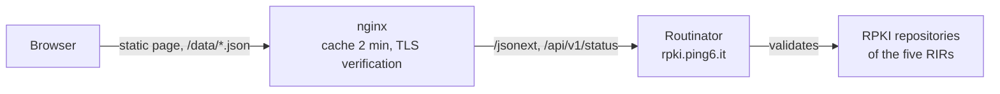

<p align="center">
  <picture>
    <source media="(prefers-color-scheme: dark)" srcset="assets/logo-dark.svg">
    
  </picture>
</p>

<p align="center">
  <strong>Browse the validated ASPA objects of the RPKI, in the browser.</strong><br>
  A small static page on top of a <a href="https://github.com/NLnetLabs/routinator">Routinator</a> validator.
</p>

<p align="center">
  <a href="https://gitlab.dei.unipd.it/Antonio-Prado/aspa-explorer/-/pipelines"></a>
  <a href="https://gitlab.dei.unipd.it/Antonio-Prado/aspa-explorer/-/releases"></a>
</p>

<p align="center">
  <a href="https://aspa.ping6.it/">Live site</a> ·
  <a href="https://aspa.ping6.it/guide.html">Guide</a> ·
  <a href="https://gitlab.dei.unipd.it/Antonio-Prado/aspa-explorer/-/wikis/home">Wiki</a> ·
  <a href="CHANGELOG.md">Changelog</a> ·
  <a href="CONTRIBUTING.md">Contributing</a>
</p>

<table>
  <tr>
    <td width="50%"></td>
    <td width="50%"></td>
  </tr>
  <tr>
    <td align="center"><sub>Look up an AS</sub></td>
    <td align="center"><sub>Overview, in the dark theme</sub></td>
  </tr>
</table>

## What is it

An **ASPA** (Autonomous System Provider Authorization) is a signed RPKI object in which a *customer* AS lists the ASes that may act as its upstream *providers*. Routers use these lists to detect route leaks and some forged AS paths.

ASPA Explorer shows every ASPA that the validator currently considers valid, so you can search it and see the big picture. It runs at <https://aspa.ping6.it/> (Department of Information Engineering, University of Padova).

## Features

- **Lookup:** type `AS680`, `as 680` or `680` to see the AS's own ASPA and every ASPA that names it as a provider. Each lookup has a shareable address (`/#AS680`).
- **Overview:** summary tiles and three charts: ASPAs per RIR, providers per ASPA, most-named providers.
- **Table:** all ASPAs, filterable by AS number and RIR, 100 rows at a time.
- **Built-in guide** in English, with an accessibility statement: [`site/guide.html`](site/guide.html).
- **Accessible:** keyboard operable, visible focus, skip link, light and dark themes, reduced-motion aware. Checked with axe-core in both themes (WCAG 2.2 AA rules) with no issues reported.
- **No build step, no dependencies, no cookies.** Strict Content-Security-Policy; remote data goes into the page only through `textContent`.

## How it works



The page fetches two same-origin JSON files, which nginx proxies to Routinator and caches:

| Page path | Routinator endpoint |
|---|---|
| `/data/aspas.json` | `/jsonext?exclude=routeOrigins,routerKeys` |
| `/data/status.json` | `/api/v1/status` |

## Repository layout

```
site/                          the web root: index.html, guide.html, style.css, app.js,
                               footer.js, version.json, favicon.svg, img/
assets/                        logo (SVG), screenshots and credit logos used in this README
deploy/nginx/aspa.conf         nginx server blocks and proxy cache zone
deploy/nginx/rpki-proxy.conf   proxy settings shared by the data endpoints
deploy/nginx/security-headers.conf   security headers (server block and /client-ip)
scripts/                       CI helpers: nginx check, version check, build info
```

## Deploy

1. Copy `site/*` to the web root (for example `/usr/local/www/aspa`).
2. Copy `deploy/nginx/aspa.conf` into nginx's `conf.d/`, and `deploy/nginx/rpki-proxy.conf` and `deploy/nginx/security-headers.conf` next to `nginx.conf`. Adjust the listen IP, server name, TLS certificate paths and the Routinator host in `rpki-proxy.conf`.
3. Write the build information shown in the footer next to `index.html`: `sh scripts/build-info.sh > build.json`.
4. Make sure the Routinator HTTP(S) port is reachable from the web server, then `nginx -t && nginx -s reload`.

## Development

No build step and no dependencies. `make check` runs the same checks as the CI pipeline: JavaScript syntax, HTML validation, nginx configuration test and version consistency. Details in [CONTRIBUTING.md](CONTRIBUTING.md).

Releases follow [Semantic Versioning](https://semver.org/); the version shown in the footer lives in [`site/version.json`](site/version.json) and must match the latest entry of the [changelog](CHANGELOG.md).

## Project documents

| | |
|---|---|
| [CHANGELOG.md](CHANGELOG.md) | release history |
| [CONTRIBUTING.md](CONTRIBUTING.md) | how to contribute |
| [SECURITY.md](SECURITY.md) | how to report a vulnerability |
| [Wiki](https://gitlab.dei.unipd.it/Antonio-Prado/aspa-explorer/-/wikis/home) | user guide, accessibility, deployment |
| [LICENSE](LICENSE) | MIT |

## Credits

<p align="center">
  Powered by <a href="https://www.dei.unipd.it"></a>
  &nbsp;&nbsp;&nbsp;
  Served by <a href="https://www.freebsd.org"></a>
  &nbsp;&nbsp;&nbsp;
  Validated by <a href="https://nlnetlabs.nl/projects/routinator/"></a>
  &nbsp;&nbsp;&nbsp;
   Made with vi <code>:wq</code>
</p>

- **Powered by DEI:** the Department of Information Engineering (DEI), University of Padova, hosts the page and the validator behind it.
- **Served by FreeBSD:** the FreeBSD logo is a trademark of The FreeBSD Foundation.
- **Made with vi:** the little `vi` icon is original (vi has no official logo); `:wq` saves and quits.
- **Validated by Routinator:** the data comes from [Routinator](https://github.com/NLnetLabs/routinator), the RPKI validator by NLnet Labs; the logo is theirs.

## License

Released under the [MIT License](LICENSE).
