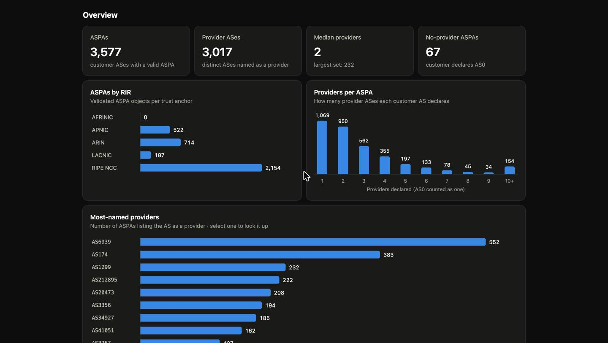
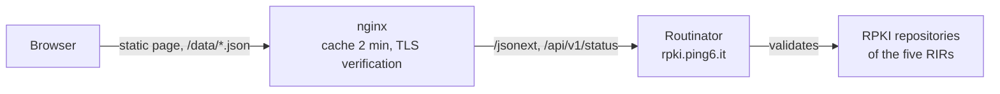

<p align="center">
  <picture>
    <source media="(prefers-color-scheme: dark)" srcset="assets/logo-dark.svg">
    
  </picture>
</p>

<p align="center">
  <strong>Browse the validated ASPA objects of the RPKI, in the browser.</strong><br>
  A small static page on top of a <a href="https://github.com/NLnetLabs/routinator" target="_blank" rel="noopener">Routinator</a> validator.
</p>

<p align="center">
  <a href="https://gitlab.dei.unipd.it/Antonio-Prado/aspa-explorer/-/pipelines" target="_blank" rel="noopener"></a>
  <a href="https://gitlab.dei.unipd.it/Antonio-Prado/aspa-explorer/-/releases" target="_blank" rel="noopener"></a>
</p>

<p align="center">
  <a href="https://aspa.ping6.it/" target="_blank" rel="noopener">Live site</a> ·
  <a href="https://rpki.ping6.it/" target="_blank" rel="noopener">Validator</a> ·
  <a href="https://aspa.ping6.it/guide.html" target="_blank" rel="noopener">Guide</a> ·
  <a href="https://gitlab.dei.unipd.it/Antonio-Prado/aspa-explorer/-/wikis/home#" target="_blank" rel="noopener">Wiki</a> ·
  <a href="CHANGELOG.md" target="_blank" rel="noopener">Changelog</a> ·
  <a href="CONTRIBUTING.md" target="_blank" rel="noopener">Contributing</a>
</p>

<table>
  <tr>
    <td width="50%"></td>
    <td width="50%"></td>
  </tr>
  <tr>
    <td align="center"><sub>Look up an AS</sub></td>
    <td align="center"><sub>Overview, in the dark theme</sub></td>
  </tr>
</table>

## What is it

An **ASPA** (Autonomous System Provider Authorization) is a signed RPKI object in which a *customer* AS lists the ASes that may act as its upstream *providers*. Routers use these lists to detect route leaks and some forged AS paths.

ASPA Explorer shows every ASPA that the validator currently considers valid, so you can search it and see the big picture. It runs at <https://aspa.ping6.it/> (Department of Information Engineering, University of Padova).

The validator is a [Routinator](https://github.com/NLnetLabs/routinator) instance run at **[rpki.ping6.it](https://rpki.ping6.it/)**, which also publishes its own web UI (<https://rpki.ping6.it/ui/>) and the raw ASPA data (<https://rpki.ping6.it/jsonext?exclude=routeOrigins,routerKeys>).

## Features

- **Lookup:** type `AS680`, `as 680` or `680` to see the AS's own ASPA and every ASPA that names it as a provider. Each lookup has a shareable address (`/#AS680`).
- **Overview:** summary tiles and three charts: ASPAs per RIR, providers per ASPA, most-named providers.
- **Table:** all ASPAs, filterable by AS number and RIR, 100 rows at a time.
- **Built-in guide** in English, with an accessibility statement: <a href="https://aspa.ping6.it/guide.html" target="_blank" rel="noopener">read it on the site</a> (source: <a href="site/guide.html" target="_blank" rel="noopener"><code>site/guide.html</code></a>).
- **Accessible:** keyboard operable, visible focus, skip link, light and dark themes, reduced-motion aware. Checked with axe-core in both themes (WCAG 2.2 AA rules) with no issues reported.
- **No build step, no dependencies, no cookies.** Strict Content-Security-Policy; remote data goes into the page only through `textContent`.

## How it works



The page fetches two same-origin JSON files, which nginx proxies to Routinator and caches:

| Page path | Routinator endpoint |
|---|---|
| `/data/aspas.json` | `/jsonext?exclude=routeOrigins,routerKeys` |
| `/data/status.json` | `/api/v1/status` |

## Repository layout

```
site/                          the web root: index.html, guide.html, style.css, app.js,
                               footer.js, version.json, favicon.svg, img/
assets/                        logo (SVG), screenshots and credit logos used in this README
deploy/nginx/aspa.conf         nginx server blocks and proxy cache zone
deploy/nginx/rpki-proxy.conf   proxy settings shared by the data endpoints
deploy/nginx/security-headers.conf   security headers (server block and /client-ip)
scripts/                       CI helpers: nginx check, version check, build info,
                               package audit, ASPA snapshot logging
deploy/freebsd/                daily refresh of the pkg vulnerability database
eslint.config.mjs              security rules for the browser code (no innerHTML, eval, ...)
```

## Deploy

1. Copy `site/*` to the web root (for example `/usr/local/www/aspa`).
2. Copy `deploy/nginx/aspa.conf` into nginx's `conf.d/`, and `deploy/nginx/rpki-proxy.conf` and `deploy/nginx/security-headers.conf` next to `nginx.conf`. Adjust the listen IP, server name, TLS certificate paths and the Routinator host in `rpki-proxy.conf`.
3. Write the build information shown in the footer next to `index.html`: `sh scripts/build-info.sh > build.json`.
4. Make sure the Routinator HTTP(S) port is reachable from the web server, then `nginx -t && nginx -s reload`.

## Development

No build step and no dependencies. `make check` runs the same checks as the CI pipeline: JavaScript syntax, HTML validation, nginx configuration test, version consistency and a security lint of the browser code. The pipeline also scans the git history for secrets (`make secrets`). Scheduled jobs audit the packages of the host weekly and log a daily snapshot of the ASPA data to the project's *Model experiments* (adoption over time); see [CONTRIBUTING.md](CONTRIBUTING.md). Details in <a href="CONTRIBUTING.md" target="_blank" rel="noopener">CONTRIBUTING.md</a>.

Releases follow [Semantic Versioning](https://semver.org/); the version shown in the footer lives in <a href="site/version.json" target="_blank" rel="noopener"><code>site/version.json</code></a> and must match the latest entry of the <a href="CHANGELOG.md" target="_blank" rel="noopener">changelog</a>.

## Project documents

| | |
|---|---|
| <a href="CHANGELOG.md" target="_blank" rel="noopener">CHANGELOG.md</a> | release history |
| <a href="CONTRIBUTING.md" target="_blank" rel="noopener">CONTRIBUTING.md</a> | how to contribute |
| <a href="SECURITY.md" target="_blank" rel="noopener">SECURITY.md</a> | how to report a vulnerability |
| <a href="https://gitlab.dei.unipd.it/Antonio-Prado/aspa-explorer/-/wikis/home#" target="_blank" rel="noopener">Wiki</a> | user guide, accessibility, deployment |
| <a href="LICENSE" target="_blank" rel="noopener">LICENSE</a> | MIT |

## License

Released under the <a href="LICENSE" target="_blank" rel="noopener">MIT License</a>.

<p align="center">
  <a href="https://www.dei.unipd.it" target="_blank" rel="noopener"></a>
  &nbsp;&nbsp;&nbsp;
  <a href="https://www.freebsd.org" target="_blank" rel="noopener"></a>
  &nbsp;&nbsp;&nbsp;
  <a href="https://nlnetlabs.nl/projects/routinator/" target="_blank" rel="noopener"></a>
  &nbsp;&nbsp;&nbsp;
  
</p>
