<p align="center">
  
</p>

<p align="center">
  <strong>Explore, check and follow the ASPA objects of the RPKI.</strong><br>
  A web page, a small API and a notification service on top of a <a href="https://github.com/NLnetLabs/routinator" target="_blank" rel="noopener">Routinator</a> validator: lookups, AS path and route checks, statistics, feeds, badges and notifications.
</p>

<p align="center">
  <a href="https://gitlab.dei.unipd.it/Antonio-Prado/aspa-explorer/-/releases" target="_blank" rel="noopener"></a>
</p>

<p align="center">
  <a href="https://aspa.ping6.it/" target="_blank" rel="noopener">Live site</a> ·
  <a href="https://rpki.ping6.it/" target="_blank" rel="noopener">Validator</a> ·
  <a href="https://aspa.ping6.it/guide.html" target="_blank" rel="noopener">Guide</a> ·
  <a href="https://aspa.ping6.it/api.html" target="_blank" rel="noopener">API</a> ·
  <a href="https://aspa.ping6.it/statistics.html" target="_blank" rel="noopener">Statistics</a> ·
  <a href="https://aspa.ping6.it/status.html" target="_blank" rel="noopener">Status</a> ·
  <a href="https://gitlab.dei.unipd.it/Antonio-Prado/aspa-explorer/-/wikis/home#" target="_blank" rel="noopener">Wiki</a> ·
  <a href="CHANGELOG.md" target="_blank" rel="noopener">Changelog</a> ·
  <a href="CONTRIBUTING.md" target="_blank" rel="noopener">Contributing</a>
</p>

<p align="center"><sub>This is the public, read-only mirror of the project's development repository (it is copied to <a href="https://github.com/Antonio-Prado/aspa-explorer" target="_blank" rel="noopener">GitHub</a> as well). To report a problem or suggest a change, write to <a href="mailto:antonio.prado@dei.unipd.it">antonio.prado@dei.unipd.it</a>.</sub></p>

<table>
  <tr>
    <td width="50%">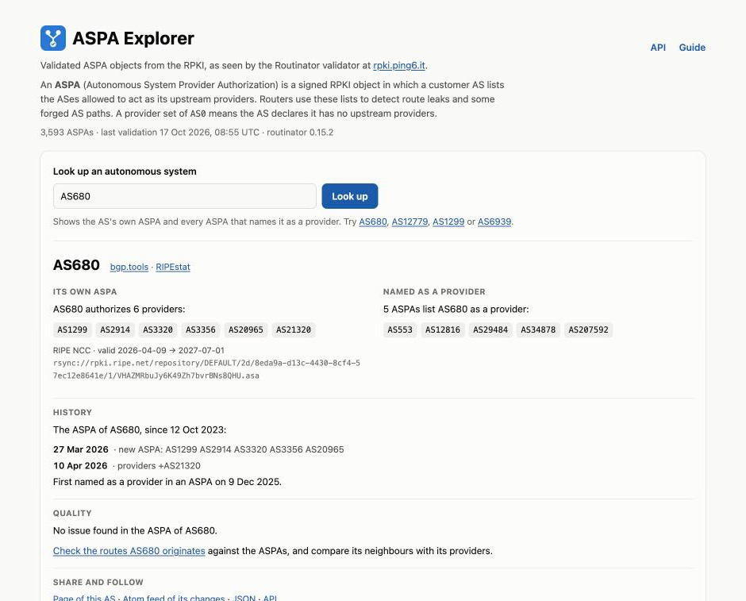</td>
    <td width="50%">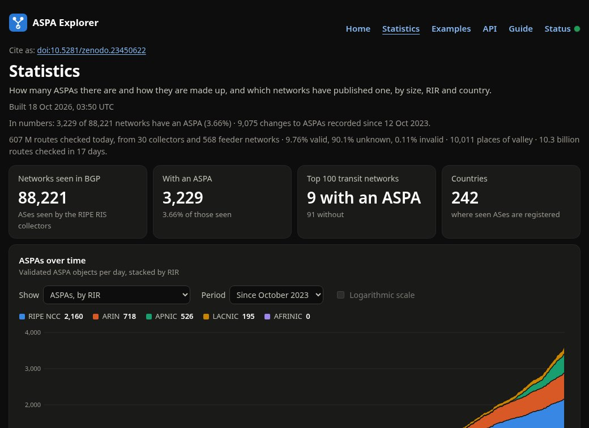</td>
  </tr>
  <tr>
    <td align="center"><sub>Look up an AS, with its history</sub></td>
    <td align="center"><sub>Statistics, in the dark theme</sub></td>
  </tr>
  <tr>
    <td width="50%">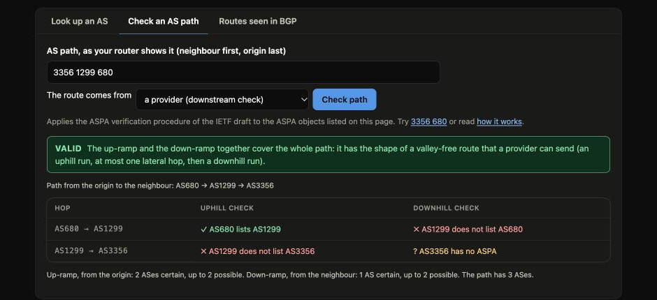</td>
    <td width="50%">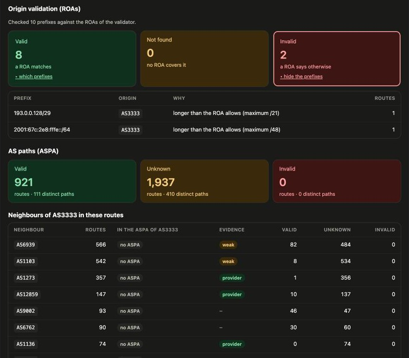</td>
  </tr>
  <tr>
    <td align="center"><sub>AS path check: verdict and hop-by-hop reasons</sub></td>
    <td align="center"><sub>Routes seen in BGP: ROAs for the prefixes, ASPAs for the paths</sub></td>
  </tr>
  <tr>
    <td width="50%">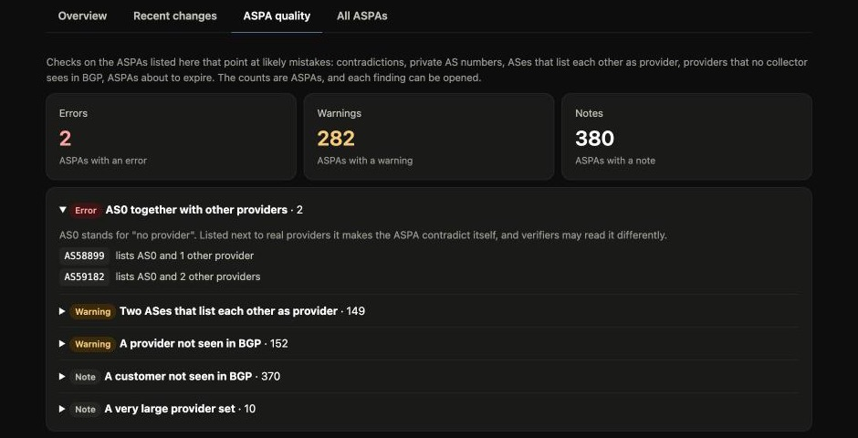</td>
    <td width="50%">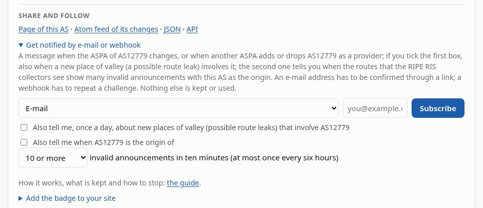</td>
  </tr>
  <tr>
    <td align="center"><sub>ASPA quality: what looks wrong in the ASPAs</sub></td>
    <td align="center"><sub>Share and follow: feed, notifications, badge, API</sub></td>
  </tr>
  <tr>
    <td width="50%">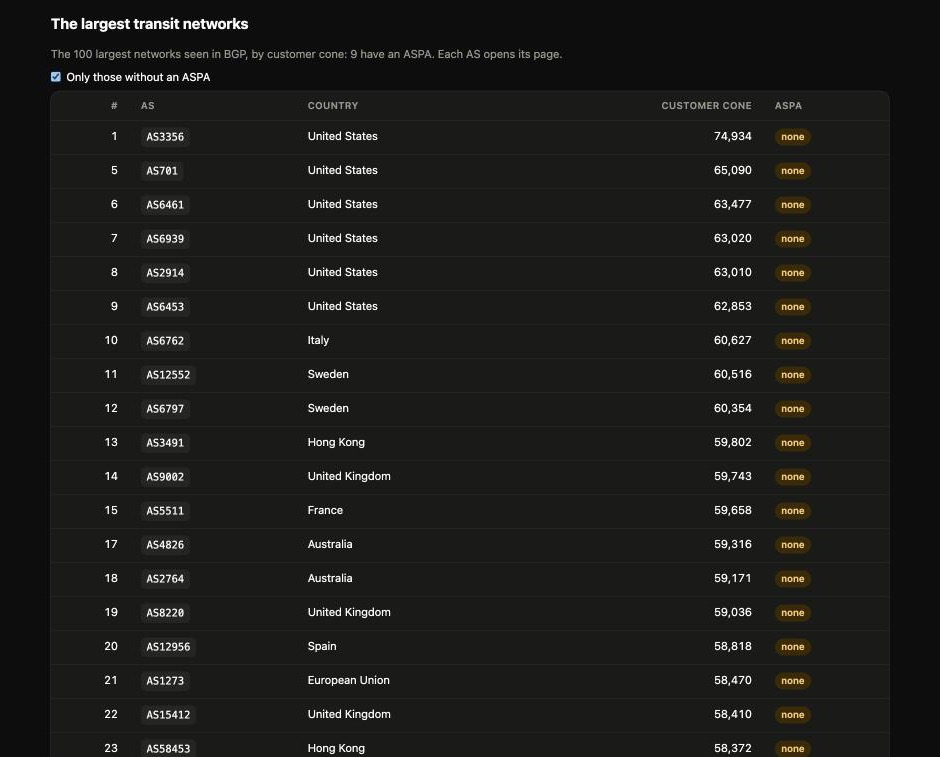</td>
    <td width="50%">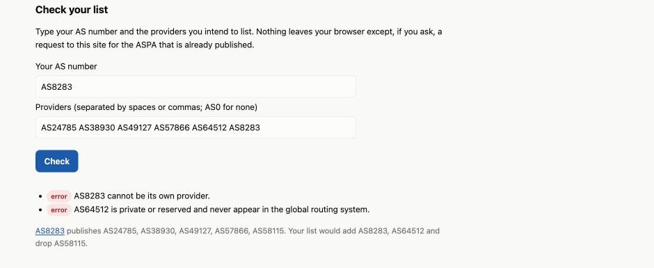<br>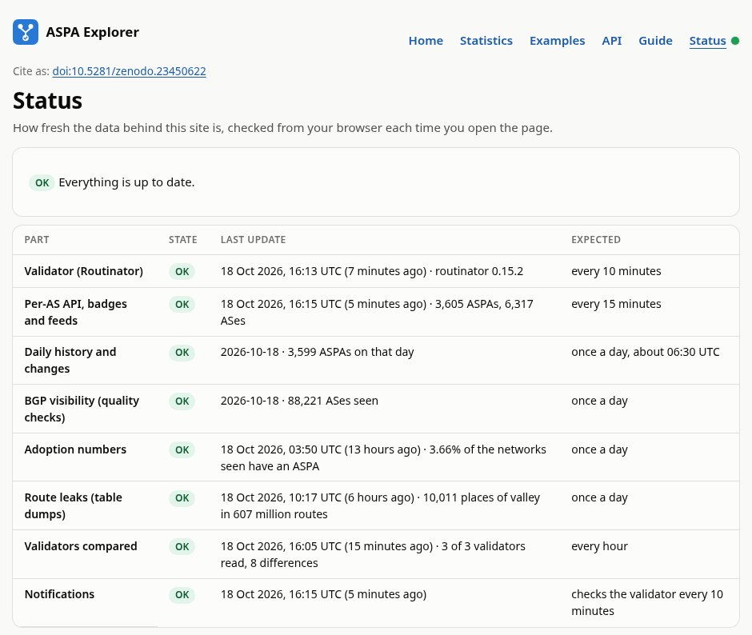</td>
  </tr>
  <tr>
    <td align="center"><sub>Adoption: by size, RIR and country, and the largest transit networks</sub></td>
    <td align="center"><sub>Examples with a checker, and the status page</sub></td>
  </tr>
  <tr>
    <td colspan="2" align="center">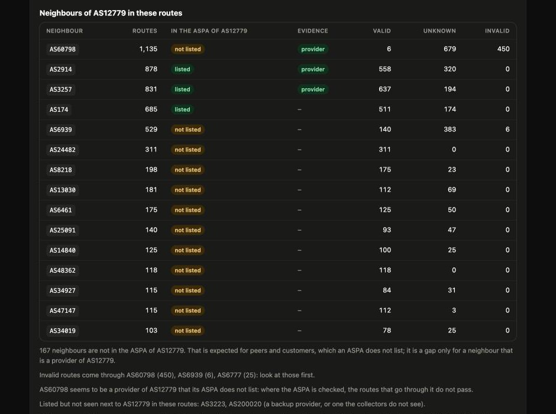<br><sub>Neighbours of an origin: the evidence of who its providers are</sub></td>
  </tr>
  <tr>
    <td width="50%">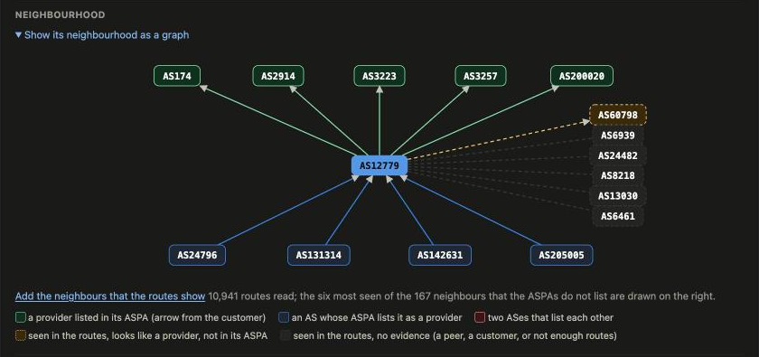</td>
    <td width="50%">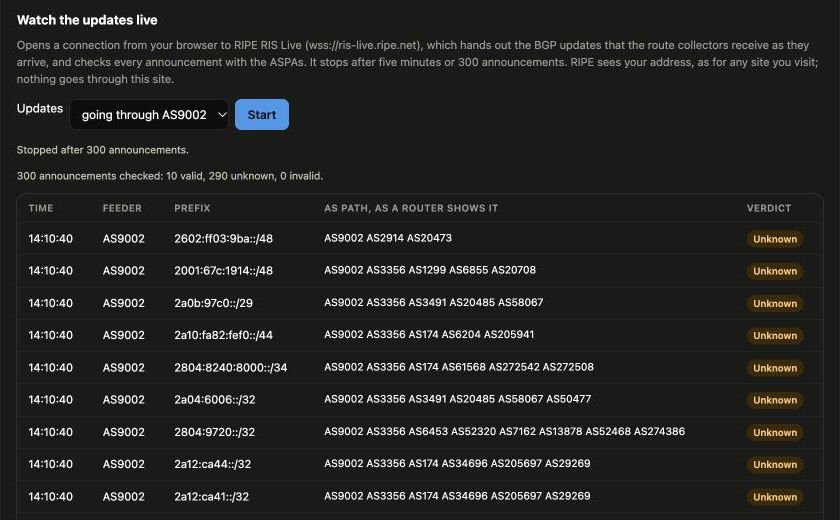</td>
  </tr>
  <tr>
    <td align="center"><sub>Neighbourhood graph, with the neighbours that the routes show</sub></td>
    <td align="center"><sub>Live updates from RIS Live, checked as they arrive</sub></td>
  </tr>
  <tr>
    <td width="50%">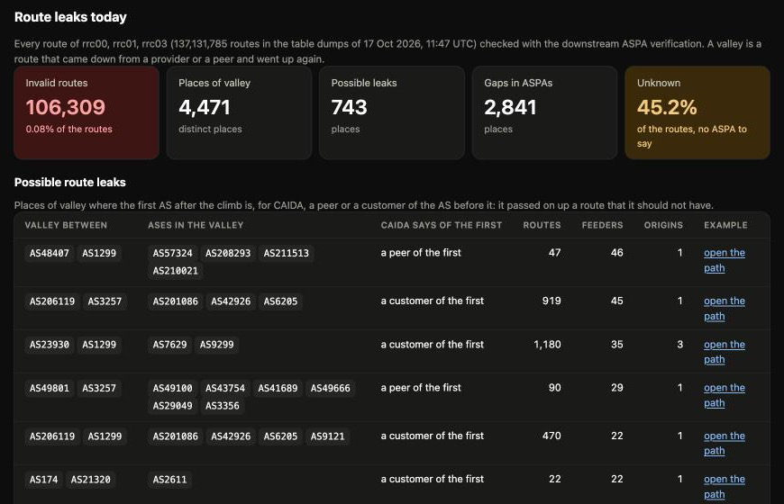</td>
    <td width="50%">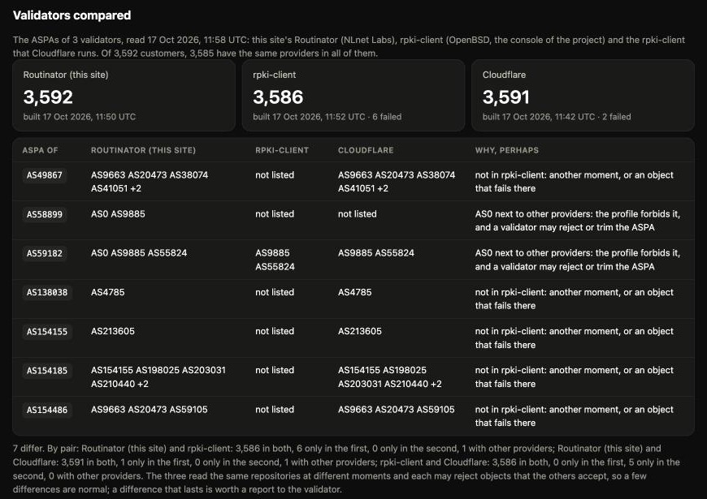</td>
  </tr>
  <tr>
    <td align="center"><sub>Route leaks seen today in the table dumps</sub></td>
    <td align="center"><sub>Validators compared</sub></td>
  </tr>
  <tr>
    <td width="50%">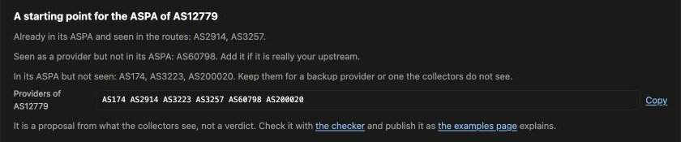</td>
    <td width="50%">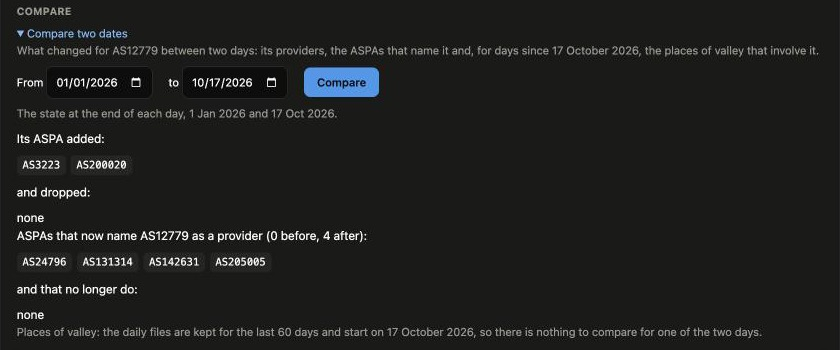</td>
  </tr>
  <tr>
    <td align="center"><sub>A starting point for an ASPA, from the evidence of the routes</sub></td>
    <td align="center"><sub>Compare two dates for an AS</sub></td>
  </tr>
  <tr>
    <td colspan="2" align="center">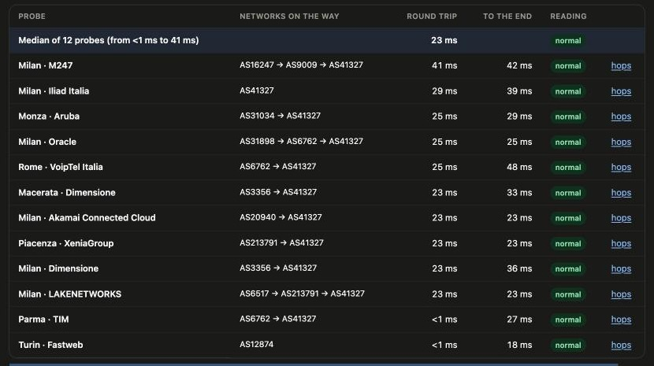</td>
  </tr>
  <tr>
    <td colspan="2" align="center"><sub>Possible tromboning: a lead to confirm with traceroutes</sub></td>
  </tr>
</table>

## What is it

An **ASPA** (Autonomous System Provider Authorization) is a signed RPKI object in which a *customer* AS lists the ASes that may act as its upstream *providers*. Routers use these lists to detect route leaks and some forged AS paths.

ASPA Explorer shows every ASPA that the validator currently considers valid, so you can search it, check AS paths and the routes seen in BGP against it, follow its changes and see the big picture. It runs at <https://aspa.ping6.it/> (Department of Information Engineering, University of Padova).

The validator is a [Routinator](https://github.com/NLnetLabs/routinator) instance run at **[rpki.ping6.it](https://rpki.ping6.it/)**, which also publishes its own web UI (<https://rpki.ping6.it/ui/>) and the raw ASPA data (<https://rpki.ping6.it/jsonext?exclude=routeOrigins,routerKeys>).

## Features

**Look up and check**

- **Lookup:** type `AS680`, `as 680` or `680` to see the AS's own ASPA, every ASPA that names it as a provider, its history and the quality findings about its ASPA. Each AS has a page of its own (`/as/AS680`) and a shareable address (`/#AS680`).
- **AS path check:** paste a path as your router shows it (neighbour first, origin last) and see whether it passes the ASPA verification procedure of the IETF draft (upstream or downstream), hop by hop, with the reason for a *Valid*, *Unknown* or *Invalid* verdict. It runs in the browser on the ASPA objects listed on the page, and a result can be shared with a link.
- **Routes seen in BGP:** for a prefix or an AS, the routes that the RIPE RIS collectors see (through RIPEstat; this box sends the prefix or the AS to RIPEstat, and the guide says so). It gives, on one page:
  - *origin validation*: every prefix and origin checked against the ROAs of the validator (valid, not found, invalid with the reason), asked of the page's own server;
  - *the AS paths* checked with the downstream procedure (valid, unknown, invalid);
  - *route leaks*: the valleys that the ASPAs prove, grouped by place, with the feeders that see them;
  - *the neighbours of the origin*, with an evidence column that says which of them look like its providers because its routes go on through them to a Tier-1 network, and which of them its ASPA does not list;
  - *possible tromboning*: the domestic routes that cross another country, a candidate in the sense of the literature to be confirmed with traceroutes.

  Evidence and tromboning are readings of the routes of the moment, with their limits stated in the page, not verdicts.
- **Live and graph:** under the routes of an AS, the updates that RIPE RIS Live hands out as they arrive, each one checked with the ASPAs (a leak shows up here while it happens); in the lookup, the neighbourhood of an AS drawn as a graph (`site/graph.js`).
- **Writing your ASPA:** an examples page with the rules, five cases, the common mistakes and a checker that reviews a list of providers and compares it with the published ASPA.

**Follow**

- **Changes:** the ASPAs that appeared, changed or disappeared in the last 14 days, an Atom feed of them (`/changes.atom`), and the history of one AS. The series is rebuilt from the RIPE NCC RPKI archive (`tools/backfill-history.py`) and extended every day by the `aspa-snapshot` job.
- **A feed and a badge for every AS:** `/feed/AS3333.atom` lists the changes of its ASPA and of the ASPAs that add or drop it as a provider; `/badge/AS3333.svg` is a badge with its number of providers (Markdown and HTML to paste are in the lookup).
- **Notifications:** subscribe an e-mail address (confirmed through a link, DKIM-signed mails with a one-click unsubscribe) or a webhook (verified by a challenge, signed with HMAC-SHA256, public https addresses only) to the changes of an AS. The service is `notifier/`, a small Node.js program with SQLite.

**Numbers**

- **Overview:** summary tiles on the home page, with the coverage (the share of the ASes seen in BGP that have an ASPA).
- **Statistics:** the charts of the ASPAs (over time since October 2023 by RIR, provider ASes, median providers, no-provider ASPAs or coverage, over any period, with a logarithmic scale and CSV/JSON download; per RIR; providers per ASPA; most-named providers) and the adoption: who has an ASPA by size of the network, RIR and country, and the 100 largest transit networks.
- **Route leaks today:** every route of ten RIPE RIS collectors (rrc00, 01, 03, 04, 10, 11, 12, 15, 19 and 23, on four continents) checked with the downstream ASPA verification once a day (`scripts/build-leaks.mjs`, a small MRT reader in `scripts/mrt.mjs`), the places of valley grouped and told apart with the CAIDA relationships into possible leaks and ASPAs that seem to miss a provider, also as `/api/v1/leaks.json`.
- **Leaks over time, alerts and comparison:** the daily totals of the leaks (`/api/v1/leaks-history.json`, a chart on the statistics page), the places of valley that involve each AS (`/api/v1/leaks-by-as.json`, and one file for each of the last 60 days), an opt-in alert for the new places that involve a subscribed AS, and *Compare two dates* on the page of an AS (providers added and dropped, the ASPAs that began or stopped naming it, its places of valley).
- **A starting point for an ASPA:** from the evidence about the neighbours of an origin, the providers to list, the ones already declared and the weak leads, with a list ready to copy.
- **Validators compared:** the ASPAs of this site's Routinator and of two rpki-client validators (the project's console and Cloudflare's), side by side every hour (`scripts/build-validators.mjs`), with the ASPAs on which they differ, also as `/api/v1/validators.json`.
- **Quality:** checks on every ASPA (AS0 mixed with other providers, a private or reserved provider, two ASes listing each other, providers no collector sees in BGP, expiring objects, very large provider sets) with counts and lists, a *Quality* block in the lookup and a *check now* link on the ASes that list each other.
- **Status:** a page and a dot in the menu that say how fresh each piece of data is (validator, API files, daily history, BGP visibility, adoption numbers, notifications).
- **Download:** the whole list of ASPAs as CSV or JSON, for one RIR or all.

**Open data**

- **Public API:** `/api/v1/as/3333` returns the ASPA, the ASPAs that name it, BGP visibility, quality findings and history as JSON (CORS open), next to `/api/v1/adoption.json`, `/api/v1/asn-registry.json`, `/api/v1/aspas.csv` and `/api/v1/aspas.json`; see `site/api.html` and the OpenAPI description in `site/api/openapi.json`.

**The project**

- **Built-in guide** in English and Italian (<a href="https://aspa.ping6.it/guida.html" target="_blank" rel="noopener">guida</a>), with an accessibility statement: <a href="https://aspa.ping6.it/guide.html" target="_blank" rel="noopener">read it on the site</a> (source: <a href="site/guide.html" target="_blank" rel="noopener"><code>site/guide.html</code></a>).
- **Accessible:** keyboard operable (tabs included), visible focus, skip link, light and dark themes, reduced-motion aware. Checked with axe-core in both themes (WCAG 2.2 AA rules) with no issues reported.
- **Plain code, no dependencies, no cookies.** The page is static JavaScript with no build step; the services behind the API, the adoption numbers and the notifications are small Node.js programs that use no package. Strict Content-Security-Policy; remote data goes into the page only through `textContent`.

## How it works

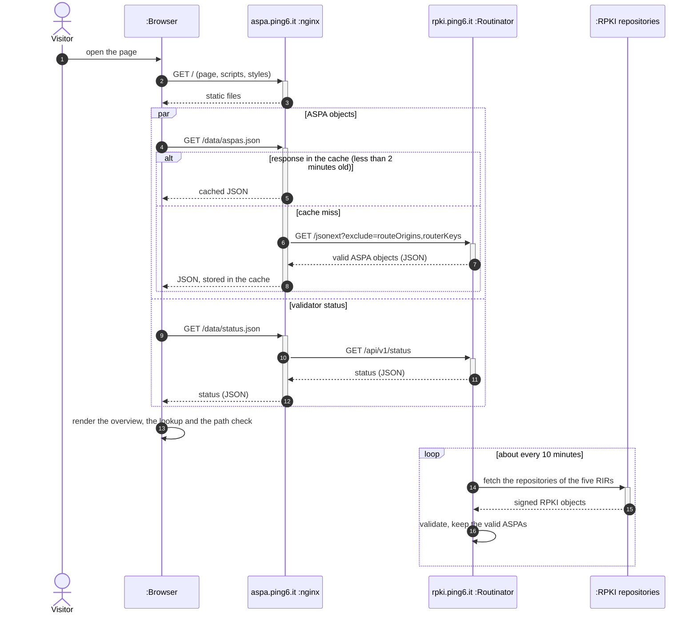

The diagram above is a UML sequence diagram of the data of the home page: the visitor's browser gets the static page from nginx and then the data, which nginx serves from its 2-minute cache or fetches from Routinator, while Routinator validates the RPKI repositories on its own schedule. Around it there are a few more pieces, which the wiki describes in *Deployment*:

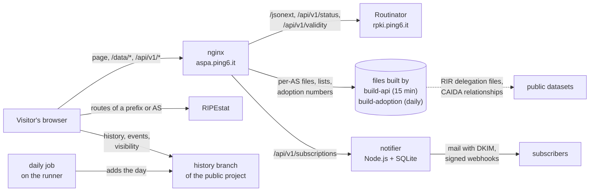

The same-origin endpoints:

| Page path | What it is |
|---|---|
| `/data/aspas.json`, `/data/status.json` | Routinator's `/jsonext?exclude=routeOrigins,routerKeys` and `/api/v1/status`, proxied and cached for 2 minutes |
| `/data/validity/AS<n>/<prefix>` | Routinator's origin validation of one route |
| `/api/v1/as/<n>`, `/badge/AS<n>.svg`, `/feed/AS<n>.atom` | files built every 15 minutes for each AS; any other AS gets a generic answer |
| `/api/v1/aspas.json`, `/api/v1/aspas.csv`, `/api/v1/meta.json` | the whole list, and when it was built |
| `/api/v1/adoption.json`, `/api/v1/asn-registry.json` | numbers built once a day |
| `/api/v1/subscriptions…` | subscriptions, confirmations, unsubscribe and health, served by the notifier |
| `/changes.atom` | the Atom feed of the changes, proxied from the history branch |

## Repository layout

```
site/                          the web root: the pages (index, guide, api, statistics, examples, status,
                               subscription), their scripts and style.css, version.json, api/openapi.json,
                               paper/ and img/
notifier/                      the notification service (subscriptions, mail with DKIM, webhooks)
scripts/                       the builders of the per-AS API (build-api.mjs) and of the adoption numbers
                               (build-adoption.mjs), the daily snapshot, release and wiki publishing, the CI
                               helpers and the unit tests (test-*.mjs)
tools/                         backfill-history.py rebuilds the history from the RIPE NCC RPKI archive
deploy/nginx/                  server blocks and proxy cache zone (aspa.conf), the proxy settings shared by
                               the data endpoints (rpki-proxy.conf) and the security headers
deploy/freebsd/                rc script of the notifier, daily refresh of the pkg vulnerability database
assets/                        logo, screenshots and credit logos used in this README
.gitlab/, .gitlab-ci.yml       issue and merge request templates, and the CI pipeline
eslint.config.mjs              security rules for the browser code (no innerHTML, eval, ...)
```

## Deploy

1. Copy `site/*` to the web root (for example `/usr/local/www/aspa`).
2. Copy `deploy/nginx/aspa.conf` into nginx's `conf.d/`, and `deploy/nginx/rpki-proxy.conf` and `deploy/nginx/security-headers.conf` next to `nginx.conf`. Adjust the listen IP, server name, TLS certificate paths and the Routinator host in `rpki-proxy.conf`.
3. Write the build information shown in the footer next to `index.html`: `sh scripts/build-info.sh > build.json`.
4. For the per-AS API, badges and feeds, run `node scripts/build-api.mjs /var/db/aspa-gen` (Node.js 18+, with `site/history.js` and `site/quality.js` next to its `../site`) every 15 minutes as an unprivileged user; it builds into a new directory and switches a `current` symlink that nginx serves. Without it the AS endpoints still answer, with "no ASPA".
5. Notifications (optional): run `notifier/main.mjs` as an unprivileged user with the `deploy/freebsd/aspa_notify` rc script (Node.js 22 with `node:sqlite`; the environment variables are listed at the top of the file), route `/api/v1/subscriptions` to it as in `deploy/nginx/aspa.conf`, and publish SPF and DKIM records for the sending domain; see the wiki, Deployment.
6. Adoption numbers (optional): run `node scripts/build-adoption.mjs /var/db/aspa-gen/adoption.json` once a day (Node.js 18+ and `bunzip2`; it downloads the RIR delegation files and the CAIDA relationships into a cache next to the output).
7. Make sure the Routinator HTTP(S) port is reachable from the web server (it must expose `/jsonext`, `/api/v1/status` and `/api/v1/validity`), then `nginx -t && nginx -s reload`.

## Development

No build step and no dependencies. `make check` runs the same checks as the CI pipeline: JavaScript syntax, HTML validation, nginx configuration test, version consistency, a security lint of the browser code and the unit tests (`make test`: the ASPA path verification, the API and adoption builders, the evidence and tromboning readings, the status checks and the notifier). The pipeline also scans the git history for secrets (`make secrets`). Scheduled jobs audit the packages of the host weekly, log a daily snapshot of the ASPA data to the project's *Model experiments* and copy the wiki to the public mirror; the builders and the notifier run on the host itself. See [CONTRIBUTING.md](CONTRIBUTING.md).

Releases follow [Semantic Versioning](https://semver.org/); the version shown in the footer lives in <a href="site/version.json" target="_blank" rel="noopener"><code>site/version.json</code></a> and must match the latest entry of the <a href="CHANGELOG.md" target="_blank" rel="noopener">changelog</a>.

## Project documents

| | |
|---|---|
| <a href="CHANGELOG.md" target="_blank" rel="noopener">CHANGELOG.md</a> | release history |
| <a href="CONTRIBUTING.md" target="_blank" rel="noopener">CONTRIBUTING.md</a> | how to contribute |
| <a href="SECURITY.md" target="_blank" rel="noopener">SECURITY.md</a> | how to report a vulnerability |
| <a href="https://gitlab.dei.unipd.it/Antonio-Prado/aspa-explorer/-/wikis/home#" target="_blank" rel="noopener">Wiki</a> | user guide, accessibility, deployment |
| <a href="LICENSE" target="_blank" rel="noopener">LICENSE</a> | MIT |

## Citation

The downstream verification implemented by the path check is analysed in the following paper (proceedings forthcoming in IEEE Xplore); the <a href="site/paper/prado-centenaro-vangelista-cscn2026.pdf" target="_blank" rel="noopener">author's accepted version (PDF)</a> is in the repository and at <a href="https://aspa.ping6.it/paper/prado-centenaro-vangelista-cscn2026.pdf" target="_blank" rel="noopener">aspa.ping6.it</a> (© 2026 IEEE; copyright may be transferred without notice, after which this version may no longer be accessible); the repository also provides a <a href="CITATION.cff" target="_blank" rel="noopener"><code>CITATION.cff</code></a>.

```bibtex
@inproceedings{prado2026aspa,
  author    = {Prado, Antonio and Centenaro, Marco and Vangelista, Lorenzo},
  title     = {Securing Multi-domain 5G/6G Routing: Towards Path Verification with {ASPA}},
  booktitle = {Proc. IEEE Conference on Standards for Communications and Networking (CSCN)},
  address   = {London, UK},
  month     = sep,
  year      = {2026},
  note      = {Proceedings forthcoming in IEEE Xplore}
}
```

## License

Released under the <a href="LICENSE" target="_blank" rel="noopener">MIT License</a>.

<p align="center">
  <a href="https://www.dei.unipd.it" target="_blank" rel="noopener"></a>
  &nbsp;&nbsp;&nbsp;
  <a href="https://www.freebsd.org" target="_blank" rel="noopener"></a>
  &nbsp;&nbsp;&nbsp;
  <a href="https://nlnetlabs.nl/projects/routinator/" target="_blank" rel="noopener"></a>
  &nbsp;&nbsp;&nbsp;
  <a href="https://en.wikipedia.org/wiki/Vi_(text_editor)" target="_blank" rel="noopener"></a>
  &nbsp;&nbsp;&nbsp;
  ❤️
</p>
