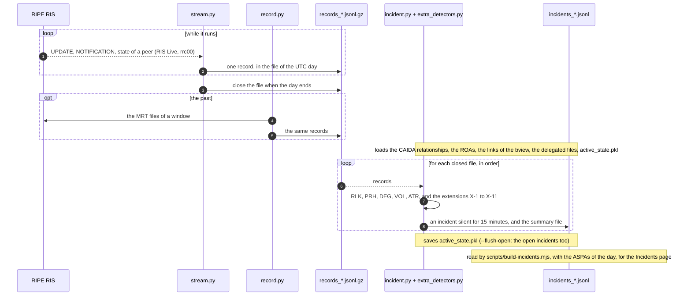

> **Corrected copy of the scripts of the research project.** These are `record.py`, `stream.py` and `incident.py` of the project `internet_routing_sec/data_scripts` (written by Yunus Atçeken), with the corrections of the cross-check of 2026-10-22 already made (source: branch `cross-check-2026-10-22`, merge request !2; what was changed and why is in `CROSS-CHECK.md` there). ASPA Explorer uses the incident files that `incident.py` writes: `scripts/build-incidents.mjs` reads them and adds the verdict of the ASPAs (the **Incidents** page). Keep this copy in step with the project: the terms of the code are those of `data_scripts`.
>
> **Extensions of this copy** (not in the project): `extra_detectors.py` adds to `incident.py` the type of the route leaks (upward, lateral), candidates of AS path manipulation (a link that the CAIDA relationships do not know, a private or unallocated AS number, an AS that comes back in the path), the prefixes in space that the RIRs list as available or reserved, deaggregation by scale (excessive and flood; a jump of an origin against its days before counts as excessive), delayed convergence and amplified churn, and the sessions that end with an UPDATE message error; and (X-12) a peer is a session, the collector and the peer AS, so that one stream can carry several collectors (the Parquet files of RIS) without adding up the withdrawals, flaps and resets of the same AS at two collectors, while what counts independent views (the peers that see a prefix flap, the more specifics that two peers have, the churn seen from many peers) stays by AS, and a state saved before X-12 is read as the sessions of `rrc00`; `stream.py` also records the NOTIFICATION and the change of state of the sessions of the peers (records of type `N` and `S`, which `incident.py` of the project ignores). Every threshold is a constant at the top of the file that applies it: `extra_detectors.py` for the extensions, `incident.py` for the flapping (`VOL_FO_*`, one incident for the prefix when 3 peers see it flap), `scripts/build-incidents.mjs` for the full propagation of a leaker (RLK-FP) and the persistent valleys (RLK-PV, a relationship that CAIDA gets wrong, told apart from the leaks). They are listed in `CROSS-CHECK.md` of the project as items X-1 to X-11, with the status EXTENDED: Yunus's repository does not have them, and its README describes them in the section on this copy. The registry files are read from `delegations/delegated-*` (`INCIDENTS_DELEGATIONS` changes it) and the links of the table of the collector at the start of the day from `links/*.txt` (`INCIDENTS_LINKS`; `scripts/rib-links.mjs` writes them from the `bview`): a link that the table already had is not a candidate of path manipulation.
>
> Run the tests with `cd tools/data_scripts && python3 -m unittest discover -s tests`.

# data_scripts

Scripts to collect BGP updates and to detect and classify routing incidents. They produce the dataset of the project: the updates seen by the route collectors, and the incidents found in them.



## Requirements

- `incident.py` uses the Python standard library only.
- `stream.py` needs `websocket-client` (`pip install websocket-client`).
- `record.py` needs [`pybgpstream`](https://bgpstream.caida.org/) (which needs `libbgpstream`).

## The records

`record.py` and `stream.py` write the same record, one JSON object for each line (`.jsonl`, or `.jsonl.gz`), for every BGP UPDATE (only updates, never table dumps):

```json
{"type": "A", "collector": "rrc00", "timestamp": "2026-10-22 10:10:10", "prefix": "185.96.212.0/24",
 "peer": 38855, "origin": 200770, "flag": 1, "compressed_path": [38855, 6939, 200770]}
```

| Field | Meaning |
| :-- | :-- |
| `type` | `A` announcement, `W` withdrawal |
| `collector` | `rrc00`, not `rrc00.ripe.net` |
| `timestamp` | UTC, to the second |
| `peer` | the ASN of the peer that feeds the collector (an integer) |
| `origin`, `flag`, `compressed_path` | for `A` only. The path has the repetitions of prepending removed (`compressed_path`), `flag` is 1 if there were any. Paths with AS-sets or confederation segments are dropped. For `W` they are `null` |

The copy of ASPA Explorer also writes two records of the session, with no prefix (`incident.py` of the project skips what has no prefix; this copy opens the ATR incidents of the sessions from them): `{"type": "N", "collector": "rrc00", "timestamp": "...", "peer": 34854, "code": 6, "subcode": 5}` for a BGP NOTIFICATION that a peer sends, and `{"type": "S", ..., "peer": 34854, "state": "down"}` for a change of state of the session. They are a few an hour.

## stream.py

Listens to [RIPE RIS Live](https://ris-live.ripe.net/) (collector `rrc00`) until Ctrl+C or `SIGTERM`, and reconnects by itself (exponential backoff). It writes one file for each **UTC day**, `records_<epoch of the opening>.jsonl.gz`, and closes it when the day ends: a gzip file is complete only once it is closed, and `incident.py` needs complete files. A record that arrives a little late (the stream is not in strict order) stays in the file of the day before. The file is flushed every 10,000 records, so a partial file can be read while the script runs (the last block may be cut).

```bash
python stream.py
```

About 1,000 updates a second from `rrc00`, a bit under 1 GB of gzip a day.

## record.py

Reads the MRT archives of the past with `pybgpstream`. The window and the collectors are set in `main()` (now `2022-11-27 00:00` to `00:10`, `rrc00`); the file is `records_<MM-DD>.jsonl.gz`.

```bash
python record.py
```

## incident.py

Reads, in order, the files `data/*.jsonl` and `data/*.jsonl.gz` and writes `incidents_<name>.jsonl` for each one (`incidents_` plus the name of the input up to the first dot), with a `summary_<name>.txt` that counts the incidents by type.

```bash
mkdir data roas
cp records_*.jsonl.gz data/
python incident.py [--flush-open]
```

Inputs in the current directory (a missing one disables its detector and says so):

- `20260901.as-rel.txt.bz2` (`CAIDA_FILE` at the top of the script): the [CAIDA AS relationships](https://www.caida.org/catalog/datasets/as-relationships/) (`as1|as2|-1` as1 is a provider of as2, `|0` peers). **Detects RLK.** The use of the dataset has to be reported to CAIDA after the publication.
- `roas/*.xz`: ROAs as `{"roas": [{"prefix": "...", "asn": "AS64500", "maxLength": 24}]}` compressed with xz (the format of the `jsonext` export of Routinator). **Detects PRH.**
- In this copy also `delegations/delegated-*` (the files of the RIRs, for the space and the AS numbers that are not allocated) and `links/*.txt` (the links of the table of the collector, see above); `run-incidents.sh` puts both in place.

Detectors:

| Type | Rule | Key of the incident |
| :-- | :-- | :-- |
| `RLK` | a hop that learned the route from a provider or a peer and sends it to a provider or a peer (valley-free violation) | `RLK_<from>_<by>_<to>` |
| `PRH` | the prefix has covering ROAs and none matches the origin (`Invalid_Origin`) or the length (`Invalid_Length`) | `PRH_<origin>` |
| `DEG` | a more specific (IPv4 /24 or longer, IPv6 /48 or longer) of an aggregate (IPv4 up to /22, IPv6 up to /32) that has a different origin, unless a ROA authorises that origin for it or CAIDA knows a link between the two origins (this copy, X-10) | `DEG_<origin>` |
| `VOL` | a prefix that flaps: at least 10 announcements and withdrawals from one peer in 300 s, seen by 3 peers or more (this copy, X-9; the project has 5, one peer, and one incident for each peer) | `VOL_<prefix>` |
| `ATR` | more than 500 withdrawals from one session in 10 s (a session is a collector and a peer AS, X-12) | `ATR_<collector>_<peer>` |

`ASM` (path manipulation) is commented out in the project until the classification is decided; this copy has candidates of its own (a link that CAIDA does not know, a private or unallocated AS number, an AS that comes back in the path: X-3, X-4, X-11).

An incident stays open while updates of the same key arrive, and is written when it has been silent for 15 minutes (10 for `VOL`) of the time of the data. It keeps at most 4 messages: the first, one in the middle that moves (powers of two), the last but one and the last. `total_updates` counts all the updates of the incident. A withdrawal counts for an incident only if the peer that sends it announced the anomaly, and for the prefixes of the incident.

The state (open incidents, the aggregates seen in the last 30 days, the more specifics that wait a day for their aggregate, the files done) is in `active_state.pkl`, so that the files can be given one at a time and in several runs. **The incidents that are still open at the end of the last file are not written**: they stay in the state until they time out in a later file. `--flush-open` writes them to `incidents_open.jsonl` with `end_reason: dataset_end` and empties them from the state.

```json
{"incident_type": "RLK", "actor_key": "RLK_1_2_3", "prefixes": ["10.1.0.0/16"],
 "start": "2026-10-22 10:00:00", "end": "2026-10-22 10:03:20", "end_reason": "timeout",
 "total_updates": 3, "details": {"anomaly": "Valley-Free Violation (Route Leak)", "from": 1, "by": 2, "to": 3, "path": [3, 2, 1, 100]},
 "messages": [ ... ]}
```

## Tests

```bash
python3 -m unittest discover -s tests
```

They use synthetic data and the standard library only (`websocket` is replaced by an empty module).

## Cross-check of 2026-10-22

All the comments on the code and the proposed changes are in `CROSS-CHECK.md` of the project `data_scripts` (not copied here). In short:

The scripts were run: `stream.py` on the live stream (27,168 updates in 25 s), `incident.py` on that file (without the CAIDA and ROA files, so only `DEG`, `VOL` and `ATR` were exercised on real data) and on synthetic cases (all the detectors). What was found and what was done:

| Finding | Evidence | Fix |
| :-- | :-- | :-- |
| `incident.py` read `data/*.jsonl` only, `stream.py` writes `.jsonl.gz` | a `.jsonl.gz` in `data/` was ignored | `DATA_PATHS` has both |
| `pending_specifics` grew without bound | 66,051 entries for 1,761 distinct (prefix, origin) in 25 s: the epoch was part of the key and every re-announcement was a new entry (1.9 MB of state in 25 s, 30 days of time to live) | one entry for each (prefix, origin) and aggregate; old states are converted. On the same 25 s: 16,299 entries, 1.1 MB of state, 34 MB of memory instead of 42 MB. It is now bounded by the number of distinct more specifics (times the 8 IPv4 or 16 IPv6 lengths above them), not by the number of updates |
| A withdrawal was added to every incident with the same prefix, whatever the peer | a withdrawal of peer 3 counted for a hijack seen by peer 4 | only the peers that announced the anomaly |
| `VOL` started at `total_updates` 1 with one message | after 25 s: 105 `VOL` incidents with totals up to 1,189 and 1 message each | starts from the flaps that triggered it, keeps up to 4 messages |
| Open incidents at the end of the last file were silently lost | the output of a short run was empty | `--flush-open`, and the behaviour is documented |
| `stream.py` had `peer` as a string and `collector` as `rrc00.ripe.net` | the first 17,596 records | integer and `rrc00`, as `record.py` and the project documentation (`STREAM.md`) |
| A gzip file can be read in full only when closed, and the file was never closed until the end | | one file for each UTC day, flush every 10,000 records |
| The summary used `jq` through a shell | | made in Python |

Open points, **not changed**, to be decided:

- **Relationships and ROAs have no date.** The CAIDA file is fixed (`20260901`) and the ROAs are those on disk: for the past the ones of the day of the incident are needed.
- **RLK** looks at CAIDA only: no handling of siblings or of the route servers of IXPs, which do not add their AS to the path. It reports the first violation of a path.
- **DEG** in the project flags every more specific with a different origin, which is often legitimate (this copy leaves out the ones that a ROA or a CAIDA link explains, X-10) (address space of a provider given to a customer, DDoS scrubbing, anycast). The retroactive case (the aggregate arrives after the specific) uses the origin of the aggregate as the actor and the other the origin of the specific, so the same event appears under two keys (`DEG_8151` and `DEG_7399` in the test). The lengths in between are never looked at (IPv4 /23, IPv6 /33 to /47).
- **PRH** only for prefixes that a ROA covers; a prefix with no ROA is not looked at.
- **End of an incident** is always `timeout`: a withdrawal does not close it.
- **Order of time.** The live stream is not in strict order (59 records out of 27,168 go back in time in 25 s); the times of the timeouts are those of the data.
- **Coverage.** One collector (`rrc00`): the incidents are those that its peers see.
- `record.py` has the window in the code and the file name without the year.
